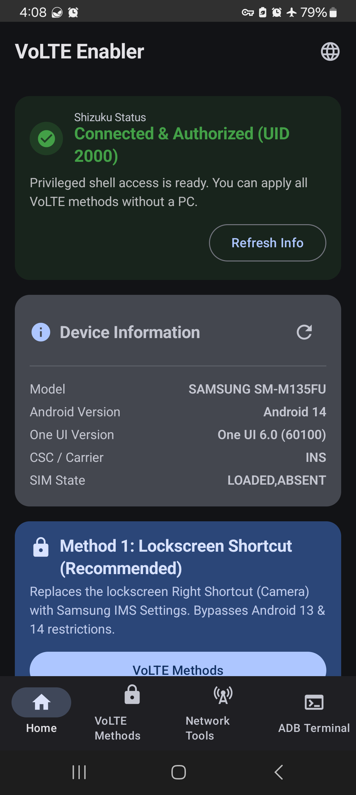
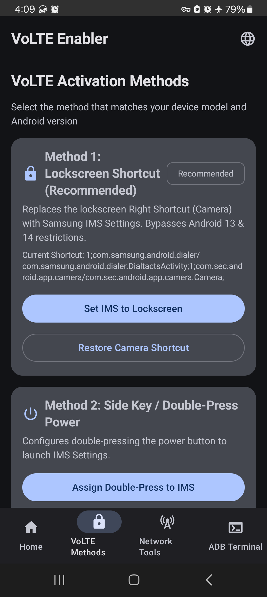
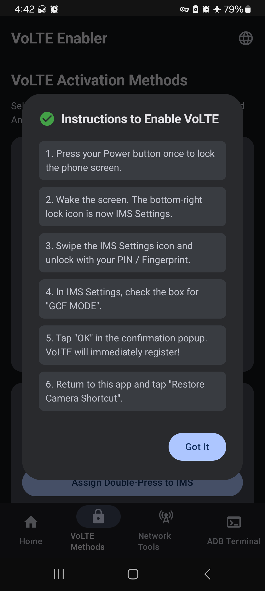
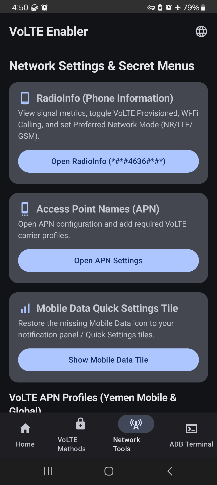
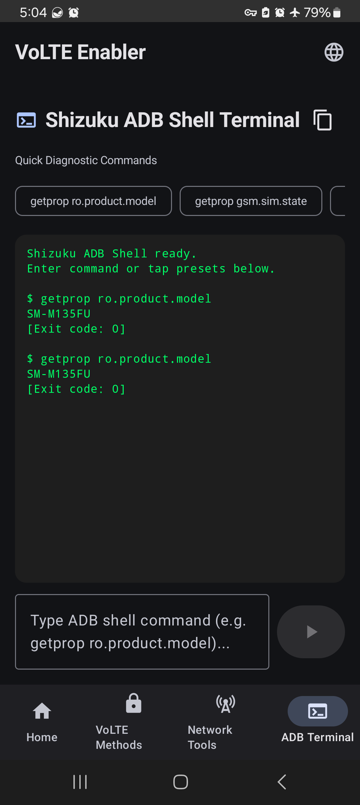
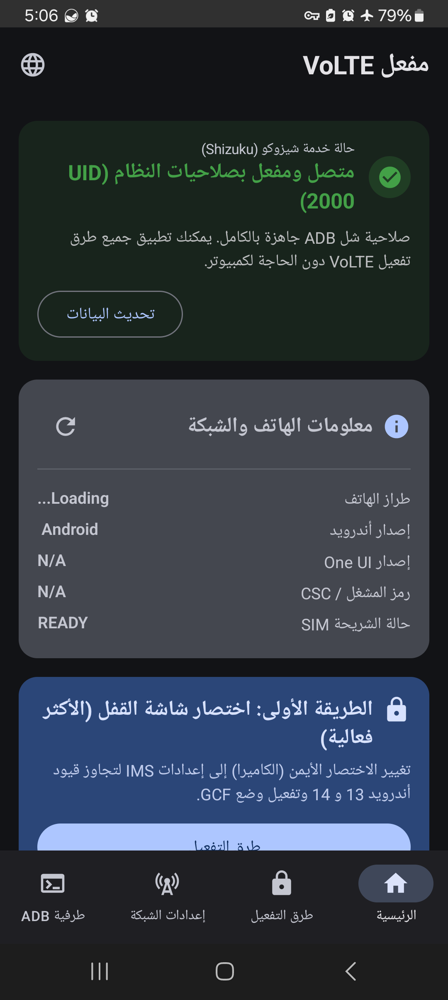

# VoLTE Enabler

**English** | [العربية](README_AR.md)

[](https://developer.android.com)
[](https://shizuku.rikka.app/)
[](https://kotlinlang.org)
[](https://developer.android.com/jetpack/compose)
[]()

A standalone native Android application that connects directly to **[Shizuku](https://shizuku.rikka.app/)** to enable VoLTE (Voice over LTE) on Samsung Galaxy and other Android devices **without requiring a PC, ADB cables, or root access**.

---

## 📸 Screenshots

| Home & Shizuku Status | VoLTE Activation Methods | Step-by-Step Guidance |
|:---:|:---:|:---:|
|  |  |  |
| **Home & Shizuku Status** | **Multiple VoLTE Methods** | **Interactive Setup Dialog** |

| Network Tools & Secret Menus | Built-in ADB Terminal | Arabic RTL Interface |
|:---:|:---:|:---:|
|  |  |  |
| **Network Tools & Secret Codes** | **Integrated ADB Console** | **Complete Arabic RTL Support** |

---

## 📖 Detailed Technical Documentation

For an in-depth explanation of how each bypass method works under the hood, why Samsung blocks unexported activities on Android 13 & 14, the raw ADB shell commands executed, and the associated Kotlin code, refer to:

👉 **[VoLTE Activation Methods & ADB Commands Reference](docs/METHODS_AND_ADB_COMMANDS.md)** (English)  
👉 **[دليل طرق تفعيل VoLTE وأوامر ADB البرمجية](docs/METHODS_AND_ADB_COMMANDS_AR.md)** (Arabic)

---

## 🎯 The Problem & Our Solution

### The Samsung One UI Restriction
On modern Samsung Galaxy devices running One UI 5 / 6 (Android 13 & 14), Samsung configured the hidden IMS Settings activity (`com.samsung.advp.imssettings/.MainActivity`) as **unexported** (`android:exported="false"`). Attempting to launch this activity via standard shortcuts or even direct ADB commands fails with:
```text
java.lang.SecurityException: Permission Denial: starting Intent { cmp=com.samsung.advp.imssettings/.MainActivity } not exported from uid 10146
```

### The Rootless Shizuku & System Bypass
**VoLTE Enabler** solves this directly on-device by utilizing Android's setting providers and **Shizuku's privileged shell (UID 2000)**:
1. **Method 1: Lockscreen Shortcut (Works 100% on Android 10–15, No Shizuku Required!)**:
   - Temporarily assigns the lockscreen bottom-right shortcut (Camera) to `com.samsung.advp.imssettings/.MainActivity` in `Settings.System`.
   - Samsung's SystemUI launches the unexported activity with system-level privileges upon swiping the lock icon.
   - Works using standard user-granted `WRITE_SETTINGS` (no root, no Shizuku, and no PC needed!).
   - Once inside, enabling **GCF MODE** (Global Certification Forum) registers VoLTE immediately with any carrier.
   - Includes 1-tap **Restore Camera Shortcut** with automatic configuration backup.
2. **Method 2: Side Key / Power Button Double-Press (Legacy Android 10–12 Only)**:
   - Rebinds the One UI power double-press trigger (`function_key_config_doublepress_value`) to open IMS Settings on Android 10–12.
   - *Note: On Android 13 & 14 (One UI 5 & 6), Samsung hardcoded a blacklist in `AdbCommandUtils` and enforces `category.LAUNCHER` in `KeyCustomizationInfoManager`, blocking this method.*
3. **Method 3: Digital Assistant Remap (Works 100% on Android 10–14 via Shizuku)**:
   - Rebinds the assistant action (`Settings.Secure.assistant`) to IMS Settings.
   - Dispatches `KEYCODE_ASSIST` (219) or Home button long-press to launch IMS Settings instantly.
   - 1-tap **Restore Google Assistant** button restores default behavior.
4. **Method 4: 1-Click IMS Package Repair**:
   - Automatically detects, enables, and reinstalls any debloated, hidden, or uninstalled Samsung IMS packages (`com.sec.ims`, `com.sec.imsservice`, `com.samsung.advp.imssettings`, `com.sec.imslogger`, `com.sec.epdg`).

---

## ⚡ Additional Built-in Features

- **Network Tools & Hidden Menus**:
  - One-tap launcher for hidden **RadioInfo (`*#*#4636#*#*`)** to toggle *VoLTE Provisioned*, *Wi-Fi Calling*, and *Preferred Network Type* (NR/LTE/GSM).
  - Direct shortcut to system **Access Point Names (APN)** settings (fixed for Android 14 to automatically pass the active data SIM `sub_id`).
  - One-tap toggle to restore the missing **Mobile Data Quick Settings Tile** (`sysui_qs_tiles`).
  - MediaTek EngineerMode, MTK Band Selection, and LG Network Settings shortcuts.
  - Power Reboot menu (Normal, Recovery, Download / Odin, Bootloader).
- **VoLTE Carrier APN Profiles**:
  - Preloaded profiles with one-tap copy buttons:
    - **Yemen Mobile 4G Data** (`ymdata`)
    - **Yemen Mobile VoLTE** (`ims`)
    - **Yemen Mobile VoLTE XCAP** (`xcap`)
    - **Generic Global VoLTE APN** (`ims`)
- **Interactive Shizuku ADB Shell Terminal**:
  - Fully featured in-app terminal console executing real-time privileged shell commands with live exit codes and standard output.
  - Preloaded diagnostic chips (`getprop ro.product.model`, `getprop gsm.sim.state`, etc.).
- **Bilingual English & Arabic (RTL)**:
  - Complete, natural Arabic localization with full Right-to-Left layout support.
  - Instant in-app language switcher button on the TopAppBar.

---

## 📋 Requirements

1. **Android Device**: Android 10.0 to Android 14+ (Samsung Galaxy One UI 2.0 to 6.1+ recommended).
2. **Shizuku App**: Installed and running on your device.
   - [Download Shizuku from GitHub](https://github.com/RikkaApps/Shizuku/releases) or Google Play.
   - Start Shizuku via **Wireless Debugging** (no PC needed) or via a one-time ADB command.
   - Grant **VoLTE Enabler** permission inside the Shizuku manager.

---

## 📥 Download & Installation

### Option 1: Direct Download (Recommended)
Download the latest ready-to-install APK (`app-debug.apk` or `app-release.apk`) directly from the **[Releases](https://github.com/HeshamNoaman/VoLTEEnabler/releases)** section of this repository and install it directly on your phone.

### Option 2: Build from Source & Install via ADB (Developers)
If you prefer compiling the project from source:

```bash
# 1. Compile Debug APK
./gradlew assembleDebug

# 2. Install onto Device via ADB
adb install -r app/build/outputs/apk/debug/app-debug.apk
```

---

## 🔒 Security & Privacy

- **No Root Required**: All privileged operations use Shizuku's secure Binder IPC mechanism (UID 2000).
- **Non-Destructive**: Every method includes an automatic backup mechanism and a 1-tap Restore button.
- **Zero Internet Permissions**: The app requires no internet access or external analytics. All operations are strictly local on your device.

---

## 📄 License

Open-source project licensed under the [MIT License](LICENSE).
